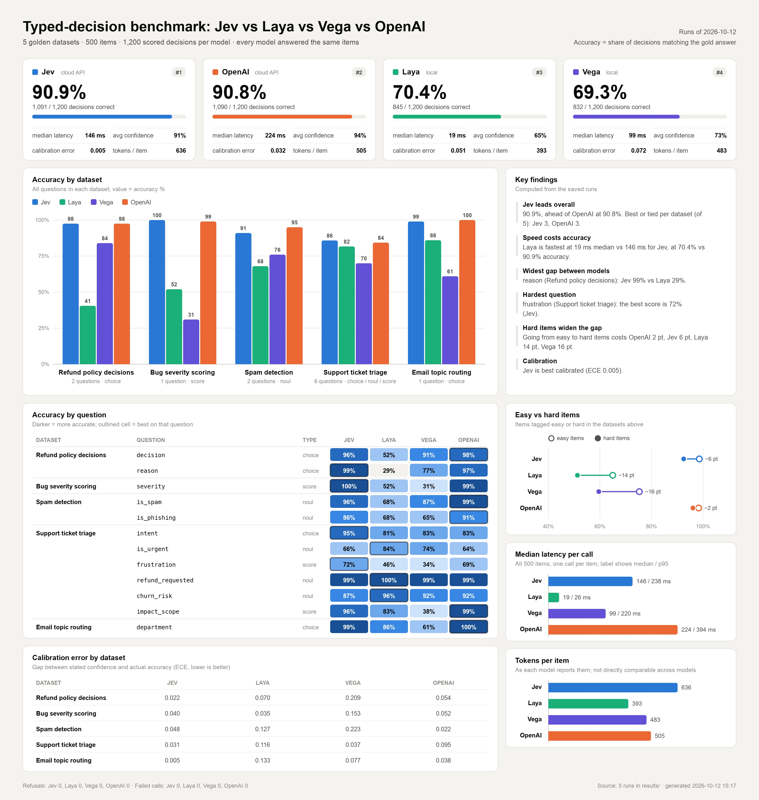

# Jev vs Laya vs Vega vs OpenAI — Typed-Decision Benchmark

A benchmark that compares four typed-decision ("System-1") models on the same golden datasets: fixed items whose correct answers are known in advance. A small Flask app runs every item through all four models, scores each answer against the known answer, streams the results to a live browser dashboard, and saves every run so it can be rescored, exported to Excel, or summarised as a one-page dashboard image.

## The models

| Model | Where it runs | Package |
|-------|---------------|---------|
| **Jev** | Cloud API from [typesafe.ai](https://console.typesafe.ai) | `jev` (imported as `typesafe_sdk`) |
| **Laya** | Locally, weights from Hugging Face ([`convaiinnovations/laya-typed-decisions`](https://huggingface.co/convaiinnovations/laya-typed-decisions), ModernBERT-large) | `laya` |
| **Vega** | Locally, in zero-shot `engine` mode ([vegaml](https://github.com/NandhaKishorM/vegaml)), 0.8B or 4B checkpoint (`VEGA_SIZE`). The results below use the **4B**. | `vegaml` |
| **OpenAI** | Cloud API: the [Decisions API](https://platform.openai.com/docs) (`POST /v1/decisions`, public beta), model `gpt-6-luna` by default | `openai` |

All four answer *typed* questions about a piece of text: pick one option (**choice**), give a yes/no probability (**noul**), or place it on a rubric (**score**).

## Results

Full runs of all five datasets (500 items, 1,200 scored decisions per model) on 2026-10-12, with Vega's 4B checkpoint.

| Test setup | |
|---|---|
| GPU | NVIDIA RTX PRO 3000 Blackwell Generation |
| Laya | `convaiinnovations/laya-typed-decisions`, on the GPU |
| Vega | 4B checkpoint (`VEGA_SIZE=4b`), on the GPU |
| Jev, OpenAI | Called over the network from the same machine; OpenAI model `gpt-6-luna` |



| Dataset | Jev | Laya | Vega | OpenAI |
|---------|----:|-----:|-----:|-------:|
| Support ticket triage | 85.8% | 81.7% | 70.0% | 84.3% |
| Spam detection | 91.0% | 68.0% | 76.0% | 95.0% |
| Bug severity scoring | 100.0% | 52.0% | 31.0% | 99.0% |
| Email topic routing | 99.0% | 86.0% | 61.0% | 100.0% |
| Refund policy decisions | 97.5% | 40.5% | 84.0% | 97.5% |
| **All decisions** | **90.9%** (1,091) | **70.4%** (845) | **69.3%** (832) | **90.8%** (1,090) |
| Median latency per call | 146 ms | 19 ms | 99 ms | 224 ms |
| p95 latency per call | 238 ms | 26 ms | 220 ms | 394 ms |
| Accuracy on easy → hard items | 98.6% → 92.5% | 64.9% → 51.2% | 75.3% → 59.5% | 98.3% → 96.0% |

Latencies for Laya and Vega are on the RTX PRO 3000 Blackwell GPU. Jev and OpenAI latencies include the network round trip.

In short:

- **Jev and OpenAI are effectively tied** for accuracy, one decision apart (1,091 vs 1,090 of 1,200). Both hold up on the deliberately hard items.
- **Laya and Vega 4B are close overall** (70.4% vs 69.3%) but strong in different places.
  - Vega 4B applies the written refund policy far better (84.0% vs 40.5%) and is ahead on spam detection.
  - Laya is ahead on bug severity, topic routing and the support-triage score questions (frustration, impact scope).
- **Laya is by far the fastest**, at a 19 ms median per call.
- **Hard items cost the local models the most**: Vega drops 16 points and Laya 14, against 6 for Jev and 2 for OpenAI.

The raw answers behind every number are in [results/](results/). Read [Points to note](#points-to-note) before drawing conclusions.

## How the comparison works

1. **Golden datasets.** Each dataset in [data/golden/](data/golden/) is a JSONL file: a header defining the questions (with their options or rubric levels), then one item per line with its input text, correct answers, tags (`easy`/`hard` plus scenario tags such as `misleading_keyword` or `calm_but_critical`) and a one-line rationale.
2. **Same input, one call per model.** For each item, every model gets the same input and all of the dataset's questions in a single call. Models are called one after another, never in parallel, and each call is timed.
3. **One answer shape.** A wrapper per vendor ([src/decision_models.py](src/decision_models.py)) translates the questions into that vendor's format and translates the answers back into one common shape. Vega calls the yes/no type `boolean`, and OpenAI calls it `predicate` and takes its questions as an ordered list.
4. **Scoring** ([src/metrics.py](src/metrics.py)):
   - **choice**: the option the model picked.
   - **noul**: `true` if the model's probability is ≥ 0.5.
   - **score**: the rubric level with the highest probability, not the rounded expected value, which would pull spread-out answers toward the middle level.
   - **confidence**: the probability the model gave to the value it actually predicted. Vendors' own `confidence` fields are not used, so confidence means the same thing for every model and question type.
5. **Saved and recomputable.** Every answer is written to `results/<timestamp>-<dataset>.jsonl` as the run goes. All metrics are recomputed from those files, so a finished run can be rescored or exported without calling any model again.

### The datasets

| Dataset | Task | Questions | Items |
|---------|------|-----------|-------|
| Support ticket triage | Six questions about a customer support email | `intent` (choice), `is_urgent` / `refund_requested` / `churn_risk` (noul), `frustration` / `impact_scope` (score) | 100 |
| Spam detection | Spam and phishing, including polite phishing and legitimate emails that look suspicious | `is_spam`, `is_phishing` (noul) | 100 |
| Bug severity scoring | Score a bug report 0–3 by its impact on users, not the reporter's tone | `severity` (score) | 100 |
| Email topic routing | Route an email to one of 7 teams, including emails with another team's keywords | `department` (choice) | 100 |
| Refund policy decisions | Apply a written refund policy to a case: approve or deny, and which rule decides | `decision`, `reason` (choice) | 100 |

Support ticket triage is synthetic. Each email is assembled from separate phrase banks, and the bank a phrase came from is its label, so the answers are correct by construction. The refund policy answers are computed by applying the policy's rules in order. The spam, severity and routing answers were written by hand with a one-line rationale each. Every item in all five datasets has been reviewed by a person. [data/golden/README.md](data/golden/README.md) covers the file format and how to review items.

### Metrics

| Applies to | Metrics |
|------------|---------|
| Every model | accuracy, average confidence, expected calibration error (ECE), refusals, failed calls, latency p50 / p95, tokens per item |
| choice | accuracy, macro F1, F1 / precision / recall per option, confusion matrix |
| noul | accuracy, precision, recall, F1, AUC, Brier score, ECE |
| score | accuracy (exact level), within one level, mean absolute error of the expected score, quadratic weighted kappa, ECE |
| Every tag | accuracy over all questions on items with that tag (for example `easy` vs `hard`) |

A refusal or a failed call counts as a wrong answer for accuracy and is left out of the probability-based metrics (calibration, Brier, AUC, MAE).

## Run it locally

### Prerequisites

- Python 3.14+
- A Hugging Face access token, recommended for downloading Laya's and Vega's weights
- A [typesafe.ai](https://console.typesafe.ai) API key, needed only for Jev
- An OpenAI API key with access to the Decisions API, needed only for OpenAI
- Enough disk space and memory for Laya (ModernBERT-large) and Vega (0.8B by default, or 4B). Both are downloaded on first use.
- An NVIDIA GPU is recommended for Laya and Vega, especially for Vega's 4B checkpoint. They also run on Apple Silicon (MPS) or on the CPU, more slowly.

You don't need all four models. A model whose key is missing is skipped and the benchmark runs with the rest, so Laya and Vega alone need no API keys at all.

### Install

```bash
git clone <repo-url> jev-vs-laya-vs-vega
cd jev-vs-laya-vs-vega

python -m venv venv
source venv/bin/activate          # Windows: venv\Scripts\activate

pip install -r requirements.txt
```

**GPU.** Laya and Vega run on a GPU when PyTorch can see one. Vega is given CUDA, then Apple's GPU (MPS), then CPU; Laya uses its library's own device choice.
- On Linux x86_64 the PyPI `torch` wheel includes CUDA, so an NVIDIA GPU is used automatically as long as the driver supports that build (check with `nvidia-smi`).
- If `python -c "import torch; print(torch.cuda.is_available())"` prints `False`, install a build that matches your driver, for example `pip install torch==2.14.1 --index-url https://download.pytorch.org/whl/cu128`.
- On macOS the standard wheel uses MPS.

### Configure

Copy the example environment file and fill in your own values:

```bash
cp .env.example .env
```

`.env` is listed in `.gitignore`, so your keys stay out of version control. `.env.example` is committed and holds placeholders only.

| Variable | Needed for | Notes |
|----------|------------|-------|
| `HF_TOKEN` | Laya, Vega | Hugging Face access token for downloading the weights |
| `TYPESAFE_API_KEY` | Jev | Get one at [console.typesafe.ai](https://console.typesafe.ai) |
| `OPENAI_API_KEY` | OpenAI | Needs access to the Decisions API |
| `VEGA_SIZE` | Vega | Vega's checkpoint size, `0.8b` (the default when unset) or `4b`, passed to `vegaml.load()`. `.env.example` sets `4b`, which matches the published results. Restart the server after changing it; the console prints `[vega] loaded the 4b checkpoint on cuda`. |
| `OPENAI_DECISIONS_MODEL` | OpenAI | Optional, not in `.env.example`. Decisions model to use; defaults to `gpt-6-luna`. |

Leave out the key for any cloud model you don't want to run. That model is skipped and the benchmark runs with the rest.

### Start the app

```bash
cd src
python app.py
```

Open **http://localhost:5050**. When the server starts, it loads Laya and Vega in the background, so your first run doesn't wait for them. The console prints `[prewarm] Laya decision model loaded and ready.` and a matching line for Vega.

1. Pick a **dataset**. The button shows its item count and questions.
2. Pick how many **items**: 20, 50 or All. 20 and 50 are a fixed subset, the same items every time.
3. Click **Run benchmark**.

While it runs you see:
- **Scoreboard**: each model's accuracy, average confidence, latency and tokens.
- **Per-question breakdown**: accuracy per question, how often the models disagreed, and who was right when they did.
- **Live feed**: each item with its correct answers and every model's prediction and confidence. You can filter it by question type.

When the run finishes, the **Results** panel compares all four models on every metric, per question and per tag, with the best value in each row underlined.

### Exports

| Output | How | What you get |
|--------|-----|--------------|
| **Excel workbook** | **Download Excel** in the Results panel, or `python src/export.py results/<run>.jsonl` | Sheets for Summary, Questions, By tag, Items (every answer, coloured right or wrong) and Confusion |
| **PDF** | **Save as PDF** in the Results panel, then "Save as PDF" in the print dialog | The scoreboard and results on a light, print-friendly page |
| **Performance dashboard** | `python src/report.py` | The one-page image shown under [Results](#results), built from the latest full run of every dataset and saved as `results/performance_dashboard.jpg` |

### Command-line tools

Run these from the project root, with the virtual environment active:

```bash
python src/golden.py                            # validate every dataset and print item / reviewed counts
python src/metrics.py results/<run>.jsonl       # print every metric for a saved run
python src/export.py results/<run>.jsonl        # write <run>.xlsx next to the run file
python src/report.py                            # write results/performance_dashboard.jpg
python src/report.py results/a.jsonl results/b.jsonl --out board.jpg   # dashboard from chosen runs only
```

Run `python src/report.py` after your benchmark runs finish to refresh the performance dashboard.

To run a benchmark without the browser:

```bash
curl -X POST localhost:5050/api/benchmark/start \
     -H 'Content-Type: application/json' -d '{"dataset": "spam_detection", "limit": 20}'
curl -N localhost:5050/api/benchmark/stream
```

## Points to note

- **Every answer has been reviewed by a person.** All 500 items are marked `"reviewed": true`, so the picker shows no review count. If you add or change items, set `"reviewed": false` until someone has checked them; the picker then shows how many are left. A wrong answer counts against every model that gets it right, so keep new items reviewed before you compare results.
- **Support ticket triage is template-based.** Its emails are built from phrase banks, so they are more regular than real email. The other four datasets include deliberately tricky items (tag `hard`).
- **Vega's checkpoint size matters.** The published results use Vega's 4B checkpoint (`VEGA_SIZE=4b`). The 0.8B gives different accuracy and latency, so check `VEGA_SIZE` before comparing your numbers with the published ones.
- **Local latency depends on your hardware.** The published Laya and Vega latencies were measured on an NVIDIA RTX PRO 3000 Blackwell Generation GPU. Expect different numbers on other GPUs, on Apple Silicon or on the CPU. Jev and OpenAI times include the network round trip, so they also depend on your connection.
- **Token counts are not comparable across models.** Laya counts every token its encoder processes (the input once per question), Vega counts the prompt tokens it reads, and Jev and OpenAI report their own billable input and output tokens. OpenAI bills input tokens only.
- **OpenAI's Decisions API is a public beta.** It can decline a single question. A refusal shows as `refused`, counts as a wrong answer and is reported separately. The API's request and response format may still change.
- **Cloud models cost money.** A full pass of all five datasets is 500 calls to each of Jev and OpenAI.
- **One run at a time.** Starting a second run while one is in progress returns an error.
- **What the dashboard image includes.** `python src/report.py` uses the latest *full* run of each dataset. A 20- or 50-item run is used only for a dataset with no full run. Each run of the command overwrites `results/performance_dashboard.jpg`.
- **Fixed subsets change if items are added.** The 20- and 50-item subsets are picked with a fixed seed, so adding or removing items in a dataset changes which items they contain.

## Project structure

```
.
├── requirements.txt
├── LICENSE                 # MIT
├── CLAUDE.md               # Guidance for Claude Code when working in this repo
├── .env.example            # Template for .env: copy it and add your keys
├── .env                    # Your API keys and settings (not committed)
├── data/golden/            # Golden datasets (JSONL) and a guide to reviewing them
├── results/                # Saved runs (one JSONL per run) and performance_dashboard.jpg
└── src/
    ├── app.py              # Flask server, API routes, Laya/Vega pre-warm on startup
    ├── decision_models.py  # One wrapper per model, translating questions and answers to a common shape
    ├── benchmark_engine.py # Benchmark loop, live totals, streamed events, saved results
    ├── golden.py           # Loads and validates the golden datasets (also a CLI)
    ├── metrics.py          # Every metric, computed from saved records (also a CLI)
    ├── export.py           # Excel export of a saved run (also a CLI)
    ├── report.py           # One-page performance dashboard JPG across runs (also a CLI)
    ├── templates/
    │   └── dashboard.html  # Dashboard UI
    └── static/
        ├── style.css
        └── dashboard.js    # Client: starts runs, reads the SSE stream, renders results
```

## API

| Method | Endpoint | Description |
|--------|----------|-------------|
| `GET` | `/` | Dashboard UI |
| `GET` | `/api/datasets` | Available datasets: name, title, item count, reviewed count, questions |
| `POST` | `/api/benchmark/start` | Starts a run. Body: `{"dataset": "<name>", "limit": <n or null for all>}`. Returns `400` for an unknown dataset or invalid limit and `409` if a run is already in progress. |
| `GET` | `/api/benchmark/stream` | Server-Sent Events stream of the current run |
| `GET` | `/api/results/<run>.xlsx` | Excel export of a saved run, where `<run>` is the file name in `results/` without `.jsonl`. Returns `404` if there is no such run. |

### Stream events

Each SSE message is a JSON object with a `type` field:

| `type` | When | Key fields |
|--------|------|------------|
| `status` | While models load | `message` |
| `model_unavailable` | A model failed to load | `model`, `message` |
| `benchmark_started` | Run begins | `dataset`, `title`, `items`, `models`, `questions`, `score_levels` |
| `item_start` | Each item | `item`, `total`, `id`, `text`, `tags`, `labels` |
| `model_error` | A single model call failed (the run continues) | `model`, `item`, `message` |
| `item_timing` | After all models answer | `latency_ms` per model |
| `answer` | For each question on each item | `question`, `qtype`, `correct`, `picks`, `disagree`, `totals`, `disagreements`, `disagreement_wins` |
| `item_done` | Item finished | `item`, `tokens` (this item), `token_totals` (running) |
| `done` | Run finished | `elapsed`, `results_file`, `metrics` (the full output of `metrics.compute`) |
| `error` | Unrecoverable failure | `message` |
| `stream_end` | Always sent last | — |

## Extending

- **Add a dataset**: put a `<name>.jsonl` file in `data/golden/` (format in [data/golden/README.md](data/golden/README.md)). It appears in the picker automatically and needs no code changes.
- **Add a question to a dataset**: add it to the header's `questions` and give every item a label for it.
- **Add a model**:
  1. Subclass `DecisionModel` in `decision_models.py` and return answers in the shape documented at the top of that file.
  2. Register it in `get_model()`.
  3. Add its name to `LANES` in `benchmark_engine.py` and `dashboard.js`.
  4. Add a display name to `MODEL_INFO` in `app.py` and `NAMES` in `export.py`.
  5. Give it a colour in `style.css` and `report.py`, and bump the lane counts in the `.scoreboard` / `.ticket-row` grids.

## Troubleshooting

- **"Jev needs a TYPESAFE_API_KEY"** or **"OpenAI needs an OPENAI_API_KEY"**: add the key to `.env` and restart the server. Until then the benchmark runs with the other models.
- **Slow first run, or "Could not preload Laya" / "Vega"**: check your network connection and `HF_TOKEN`. The weights are downloaded into the Hugging Face cache the first time.
- **Laya or Vega is slow on a machine with an NVIDIA GPU**: run `nvidia-smi`. If it can't reach the driver, PyTorch falls back to the CPU; fix the driver install, then check `torch.cuda.is_available()`.
- **A dataset is missing from the picker**: run `python src/golden.py`. It prints why a file failed validation.
- **"A benchmark run is already in progress"**: wait for the current run to finish.
- **`report.py` says there are no saved runs**: run a benchmark first. The dashboard is built from the `.jsonl` files in `results/`.
- **Port 5050 already in use**: change `port=` at the bottom of `src/app.py`.

## Tech stack

Flask 3.1 · python-dotenv · PyTorch 2.14 · `laya` 0.3.5 · `jev` 0.3.0 · `vegaml` 0.6.1 · `openai` 3.28.0 · `openpyxl` 3.1.5 · `matplotlib` 3.11.2 · vanilla JavaScript with Server-Sent Events

## License

MIT. See [LICENSE](LICENSE).
